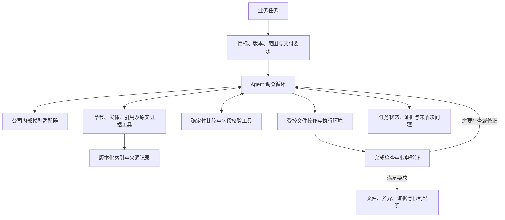

# JEDEC 知识图谱 Agent 技术报告

## 从文件读写工具到可靠任务执行：原理、难点与公司内部部署路线

日期：2026-11-01。适用范围：Python 框架、章节嵌套 JSON 知识图谱、多版本 JEDEC 数据、公司内部模型服务。

本文区分三类内容：公开资料支持的机制与研究结论、本项目已经实现和验证的能力、建议下一阶段建设的能力。示例中的参数和数值均为虚构，不表示任何真实 JEDEC 要求。

## 1. 核心结论

Coding agent 可以操作文件，是因为应用把模型连接到了真实的工具执行器与运行环境。模型提出动作，应用检查并执行动作，操作系统决定进程实际上能访问什么。文件权限不来自模型的文字，也不来自某个模型品牌。

普通问答或传统 RAG 系统通常只实现“检索后生成回答”，没有配置可执行的文件工具，因此不能直接完成文件操作。但这种限制属于应用设计，不是 RAG 的原理限制。为 RAG 应用增加文件工具和相应执行流程后，同样可以输出文件。

文件读写函数和最小工具循环容易实现；让系统在真实任务中持续做出正确决策、发现错误、保持上下文、验证产物并可靠恢复，才是主要工程难点。成熟 coding agent 的表现来自模型、工具接口、harness、运行环境、反馈与评测的共同作用，不能通过复制几个文件函数获得。

本项目推荐“内部模型 + 独立 harness + JEDEC 领域工具”。当前 V2 是可运行的基础底座，已经验证工程链路，尚未证明真实模型的业务任务完成率。公司禁止的厂商 SDK 和外部模型 API 不属于这条部署路线。

## 2. 概念与职责边界

### 2.1 哪个部分在做什么

| 组成 | 职责 | 一个具体例子 |
| --- | --- | --- |
| 模型 | 理解任务、提出下一步动作、解释结果 | 决定先查参数所在章节，再查适用条件 |
| 工具协议 | 约定工具名称、参数和返回值 | `read_file(path, offset, limit)` |
| 工具执行器 | 执行被允许的真实操作 | Python 打开文件并读取指定内容 |
| Harness | 组织调用循环、上下文、状态和错误处理 | 把读取结果交给模型，再执行其下一步请求 |
| 执行环境 | 提供文件、进程及资源边界 | 公司服务器上的工作目录或隔离容器 |
| 权限机制 | 限制可读写范围、执行与网络能力 | 只读 inputs，可写 work/outputs |
| 领域工具 | 提供业务上明确的操作 | 对齐版本记录、比较参数、查原始证据 |
| 验证器 | 判断产物是否符合可检查的要求 | 文件能加载、参数一致、引用版本正确 |

“Harness”在不同项目中的覆盖范围并不完全一致。有的包含工具实现与执行环境适配，有的主要指模型调用循环与上下文/状态管理。本文采用较宽的工程定义：围绕模型、让其受控地持续执行任务的运行管理代码。沙箱仍应被看作独立的系统安全边界。

### 2.2 Agent、工作流和 RAG 如何组合

```text
问答应用：输入 → 模型 → 文本回答

检索增强应用：输入 → 检索证据 → 模型 → 有依据的回答

固定工作流：输入 → 固定检索 → 固定比较 → 模板报告 → 校验

Agent：输入 → 模型决定动作 → 工具执行 → 结果反馈 → 模型决定下一步 → …
```

这些形态可以组合。确定性参数比较适合程序，证据获取可以使用检索，探索未知结构或调查冲突可以交给 agent。不要仅因为需要保存文件就把全部业务逻辑改成自主 agent。

Anthropic 的公开方法论将预定义执行路径与模型动态控制工具使用区分开来，并建议从足够简单的方案开始。这里引用的是架构原则，不是推荐公司接入其服务。[公开方法论](https://www.anthropic.com/research/building-effective-agents)

## 3. Coding agent 为什么能读写文件

### 3.1 一次文件写入的真实过程

假设用户要求：“根据已核实的差异生成报告，保存到 outputs/report.md。”

1. 应用把任务、相关证据、工具说明交给模型。
2. 模型输出结构化调用，例如：

```json
{
  "name": "write_file",
  "arguments": {
    "path": "outputs/report.md",
    "content": "报告正文"
  }
}
```

3. Harness 将名称映射到已注册的 Python 函数，检查参数类型。
4. 权限层把相对路径解析到工作区，拒绝越界或不可写目录。
5. 工具执行器调用实际文件操作；若覆盖已有文件，还应检查当前版本或哈希。
6. 操作系统按进程身份和文件权限决定操作能否成功。
7. 工具返回实际结果：路径、写入状态、文件哈希，或明确的错误。
8. Harness 把结果交回模型；后续可读取文件、检查内容或修正错误。

模型输出的是操作请求。工具描述本身不会执行文件操作。OpenAI 官方函数调用文档同样把工具调用描述为模型与应用之间的多步交互；引用其协议说明并不意味着本项目依赖其服务。[函数调用说明](https://developers.openai.com/api/docs/guides/function-calling)

### 3.2 为什么仅在提示词里写“你可以读写文件”不够

没有执行器时，模型只能生成类似“我已保存报告”的文字。是否真的写入，必须由执行结果和磁盘文件确认。类似地，函数 schema 只是调用协议：如果应用没有实现函数、没有解析模型动作，或执行进程没有权限，文件都不会被写入。

工程上应把“模型说做了”与“工具确认做了”分开记录。最终报告中的文件链接应指向实际存在的产物，不能由模型随意编造。

### 3.3 权限与能力的四个层次

| 层次 | 应回答的问题 |
| --- | --- |
| 工具可见性 | 模型是否能看见并请求这个工具？ |
| 应用授权 | 当前任务是否允许该类操作和目标路径？ |
| 系统权限 | 执行进程在操作系统中是否真的有访问权？ |
| 结果验证 | 操作是否成功，内容是否符合要求？ |

隐藏某个工具不是完整的系统隔离：若同时开放了不受限制的 Python/shell，模型可能通过程序完成同样的文件访问。反过来，操作系统允许读写，也不代表应用必须向模型暴露全部目录。

云端 agent 能写的是云端执行环境中的文件。它不会因此自动获得用户电脑的目录。跨越环境边界需要明确的挂载、同步或受控接口。

### 3.4 文件工具为什么不等于沙箱

`cwd=workspace` 只改变程序的当前目录。普通 Python 程序仍可能使用绝对路径访问其他目录、读取账户配置或发起网络请求。把“禁止越界”写进 system prompt 也不会改变进程权限。

对于不可信生成代码，应由公司批准的容器、受限账户或作业平台提供隔离。文件工具自身仍需检查路径和修改冲突，但它与操作系统隔离解决的是不同层次的问题。

## 4. 既然读写很简单，为什么成熟 coding agent 很难

### 4.1 早期实现已经存在

2024 年的 SWE-agent 已研究让语言模型浏览仓库、编辑代码和运行测试，并说明专门设计的 agent-computer interface 会影响任务表现。因此，工具调用与文件操作并不是最近才出现的想法。其论文支持“接口设计会影响 agent 效果”这一结论，而不是“有了编辑工具就能稳定解决所有任务”。[SWE-agent 原始研究](https://proceedings.nips.cc/paper_files/paper/2024/hash/5a7c947568c1b1328ccc5230172e1e7c-Abstract-Conference.html)

不宜把产品进步归因于单一技术。评估一个系统时，必须同时考察所用模型、允许的工具、环境反馈、上下文组织、计算预算和任务定义。

### 4.2 会执行动作与会选择正确动作不同

`write_file` 能把任意给定内容准确写入磁盘，但它不会判断该内容是否符合标准。模型仍要判断应修改哪个对象、要查哪些证据、是否存在例外、是否应该停止。工具链解决操作渠道，模型和领域工具共同解决决策。

因此，把相同 harness 接给不同模型可能获得不同效果。内部模型若经常误解要求、遗漏条件或输出错误参数，增加工具数量不能自动补齐这些能力。应在固定任务集上比较结果，而不是根据模型名称推断可用性。

### 4.3 多步任务会积累错误

假设每步正确率都是 95%，任务需要连续正确执行 20 步，并且各步独立、没有恢复机制，那么全程正确的概率约为 `0.95^20 = 35.8%`。这只是说明误差累积的简化例子，不是对真实 agent 的成功率估计。

真实系统可以通过验证、重试与回退恢复，但也可能反复扩大错误。Harness 要区分：格式错误可以要求模型修正；权限拒绝不能盲目重试；外部请求超时要判断是否已经产生副作用；证据缺失不应通过编造补齐。

### 4.4 工具接口直接影响模型的行动质量

| 粗糙接口 | 更有用的反馈 | 为什么有帮助 |
| --- | --- | --- |
| 返回整个大文件 | 结构摘要、内容窗口、继续读取位置 | 模型能决定下一步读哪里 |
| 只说“编辑失败” | 指出旧内容不匹配或匹配多次 | 模型能重新定位而不是乱改 |
| 返回数千条搜索命中 | 有限结果、来源位置、截断标志 | 防止把部分结果误当全部证据 |
| 只返回“成功” | 文件路径、哈希、退出码、校验结果 | 为完成判断提供可检查依据 |
| 任意关系都叫 related | 区分原文引用、抽取关系、算法推导 | 避免把算法关联解释成规范事实 |

工具不能只追求参数少或代码短。它应该让模型清楚知道输入约束、返回内容、失败原因和结果覆盖范围。

### 4.5 上下文管理不是简单保存聊天记录

长任务会积累检索片段、执行日志、失败尝试和中间结论。全部保留会占满上下文；过度压缩又可能丢失关键条件、证据出处或未完成事项。

需要区分：稳定的任务目标、固定输入快照、已验证证据、候选结论、未解决问题、产物和执行记录。大工具结果可存磁盘，模型按需读取；结构化状态用于恢复工作，原始事件日志用于审计。摘要可以帮助导航，但不应取代原始证据。

### 4.6 验证完成比写入文件更难

文件存在只证明发生了 I/O。有效 JSON 只证明结构可解析。一个完整测试套件通过，也不一定覆盖用户实际关心的行为。

在 JEDEC 任务中，报告可能引用了正确章节，却把另一工作条件下的参数当成目标条件。这样的报告在语法与排版上都正确，业务结论仍然错误。必须把格式检查、数值核对、证据支持和适用范围分别验证。

Anthropic 的长任务公开实践记录了上下文切换后丢失进展、任务未完成就宣告完成等问题，并讨论了进度记录、增量工作与验证的作用。这说明更长的循环和上下文压缩本身不能保证可靠交付。[长任务实践](https://www.anthropic.com/research/effective-harnesses-for-long-running-agents)

### 4.7 恢复与幂等存在工程细节

假设报告已经写入，但程序在保存“写入完成”事件前崩溃。重启后如果重放动作，可能重复生成或覆盖用户修改；如果直接跳过，又可能遗漏未成功的操作。

生产系统需要区分任务 ID、动作 ID、输入版本、预期哈希、写入结果和完成状态。临时文件替换可以避免部分写入，但不能单独解决所有跨进程竞争和恢复问题。对不同副作用工具，需要分别设计幂等键、条件写入或人工恢复策略。

### 4.8 性能、成本与体验也属于能力

一个能成功完成任务但经常读取整图、重复搜索和无限重试的系统，未必适合业务。应限制工具返回大小、规划合理的查询、缓存可复用结果，并设置时间和调用预算。

也不能把“预算耗尽”包装成“任务完成”。完成、证据不足、等待用户信息、执行失败、预算耗尽应该是不同状态。部分成果可以交付，但覆盖范围和未完成内容必须明确。

## 5. 公司不能使用厂商 SDK/API 时如何复用

### 5.1 区分三种“复用”

| 方式 | 含义 | 当前场景中的选择 |
| --- | --- | --- |
| 产品/runtime 复用 | 启动原产品的执行引擎或通过 SDK 控制它 | 不作为当前公司部署路线 |
| 开源代码/组件复用 | 在准入与许可证允许范围内采用代码 | 可单独评估，不能默认所有源码都可获得 |
| 机制复用与独立实现 | 根据公开机制实现工具循环、状态与权限 | V2 采用的路线 |

SDK 是调用入口，不等于模型本身；开源代码也不等于可直接嵌入任何语言和部署环境。仅更换 API 地址不能证明整个产品已经满足公司的软件准入和出站要求。

### 5.2 内部模型需要提供什么

最低条件是模型能接收任务与观察结果，并生成可解析的下一步动作。V2 提供两条适配路径：

- `chat_tools`：模型服务支持结构化工具调用字段。
- `json_actions`：模型服务返回文本，模型按约定输出工具动作 JSON 或最终回答 JSON。

兼容消息格式不意味着请求发往某家厂商。实际目的地由明确配置的 endpoint 决定。内部服务采用自定义认证头、payload 或响应 envelope 时，应修改适配器，不应把业务工具绑到某个 SDK。

纯文本 JSON 动作模式扩大了可接入模型的范围，但格式稳定性和规划能力仍需实测。对任意模型输出直接 eval/exec 不属于本方案。

## 6. JEDEC/KG 场景中“聪明”应具备哪些可观察行为

将“聪明”拆成可验收的行为，才能确定开发优先级。

| 能力 | 合格行为 | 典型失败 |
| --- | --- | --- |
| 版本意识 | 明确并固定所用标准和快照 | 混用两个版本的条件和数值 |
| 主动补证 | 查父章节、引用与注释 | 找到一句话就直接回答 |
| 冲突处理 | 解释冲突来源并列出未确定项 | 随意选一个值或平均两个要求 |
| 关系辨别 | 区分原文、抽取和算法关系 | 把图上连通当作原文规定 |
| 自我修正 | 根据工具错误调整动作 | 反复执行完全相同的失败操作 |
| 范围意识 | 说明检索和比较覆盖范围 | 把 Top-k 片段当成全量比较 |
| 交付意识 | 生成产物并检查内容 | 仅在文本中声称已经保存 |
| 不确定性表达 | 明确证据不足和待复核项 | 用模型记忆补成标准结论 |

这些行为应通过任务日志、证据链和验收集观察，不能只通过一个很长的 system prompt 宣告已经具备。

## 7. 建议的目标架构



关键关卡由程序控制，调查步骤允许模型动态选择。先采用单 agent，避免在没有验证收益前引入复杂的多 agent 编排。明确的固定步骤可以继续使用普通 Python 工作流。

### 7.1 数据契约

需要保存标准标识、JEDEC 版本、源文件哈希、图谱快照、解析器版本和图算法版本。当前业务中的版本主要指 JEDEC 版本，但实现上仍需记录后面几项，否则无法判断差异来自标准修订还是处理管线变化。

章节记录应保留层级、原文位置和引用。参数实体应保留单位、上下限、适用条件及证据关联。算法生成的边应保留来源类型与算法信息；分数可以作为检索线索，但不能直接当作结论真实概率。

### 7.2 证据与结论分离

```json
{
  "task_id": "example-task",
  "snapshots": ["A_snapshot", "B_snapshot"],
  "scope": ["PARAM_X"],
  "evidence": ["evidence_A_12", "evidence_B_18"],
  "claims": [
    {
      "text": "PARAM_X 的最小值发生变化",
      "evidence_ids": ["evidence_A_12", "evidence_B_18"],
      "status": "needs_condition_check"
    }
  ],
  "unresolved_questions": ["两版的适用条件是否一致"],
  "artifacts": [],
  "checks": []
}
```

上面是建议的下一阶段结构，不是当前 V2 已经实现的完整数据模型。模型写出的状态标签不等于验证通过；程序应检查来源存在、版本一致，业务规则或人工标注再检查证据是否充分支持结论。

## 8. 三类核心任务如何实现

### 8.1 有依据的问答

输入问题后先锁定版本和对象；若歧义影响结果，则要求澄清。检索候选实体/章节后读取上下文，必要时查父章节、显式引用和表格注释。把“原文直接支持”“依据证据推导”“无法确认”区分开来。

例如问 PARAM_X 的要求，仅找到值 10 还不够，必须查明单位、上下界含义和适用条件。若 KG 没有原文，回答只能标明依据为抽取记录，不能假装已经核对原标准。

### 8.2 两个版本的比较

```text
固定快照 → 对齐章节/实体 → 程序计算差异 → 核对条件与来源
         → 模型解释变化 → 验证与覆盖统计 → 导出报告
```

稳定 ID 可直接对齐；没有稳定 ID 时，需要候选匹配、多个信号核对和待确认状态。条款移动、重编号、拆分、合并应分别处理。不能仅凭编号相同就认为同一条款，也不能仅凭 ID 不同就断言新增/删除。

参数比较先处理单位、数值范围和适用条件，再讨论含义。模型适合解释变化和发现需要补查的问题；遍历记录、数值比较和统计应尽量由程序完成。

全版本比较必须覆盖指定范围内全部记录，报告已对齐数、未匹配数、解析失败数和排除范围。主题比较可以使用检索缩小范围，但必须标明它是主题范围比较，不能推广成全标准的完整修订清单。

### 8.3 生成或修改文件

报告生成可以先输出结构化差异，再生成可读 Markdown。修改测试配置则需要更多约束：目标文件及当前哈希、允许修改的字段、适用产品/工作条件、来源证据和下游校验器。

推荐在工作副本上生成修改，输出 diff，运行格式检查与业务校验；通过后再按任务授权交付或替换。当前 V2 仅提供文件工具与检查基础，尚未实现 JEDEC 驱动的测试配置业务规则。

## 9. 常见失败与对应建设项

| 观察到的失败 | 优先排查 | 建议机制 |
| --- | --- | --- |
| 找不到条款 | 索引、别名、文本提取 | 混合检索、章节导航、实体词表 |
| 命中内容但结论错误 | 模型理解、上下文缺失 | 条件补查、结构化证据、领域示例 |
| 混用版本 | 工具缺少版本约束 | 任务快照锁定、版本校验 |
| 图谱差异被当成标准变化 | 来源和管线信息缺失 | 原文回查、解析/算法版本记录 |
| 无法匹配的条款被误报删除 | 对齐方法过于简单 | 候选匹配、拆分合并、待确认分类 |
| 模型无限重复 | 错误没有分类、状态不可见 | 重复动作检测、预算和停止条件 |
| 文件被错误覆盖 | 没有版本前置条件 | 哈希检查、唯一匹配、工作副本 |
| 中断后重复执行副作用 | 缺少动作状态 | 幂等标识、恢复核查、明确重放规则 |
| 声称完成但产物无效 | 完成依据只有模型文本 | 独立产物检查和业务验收 |

这些是建议建设项，不应把表格本身当作功能已经完成的证明。

## 10. 当前 V2 的实现与证据

| 项目 | 当前状态 | 仍需补充 |
| --- | --- | --- |
| 文件读写、搜索和修改 | 已实现并测试 | 恶意并发下的系统级保障 |
| 工具循环、状态日志、预算上限 | 已实现并测试 | 生产级恢复、上下文压缩 |
| 内部模型协议 | 两种协议通过模拟 HTTP 联调 | 公司真实模型及认证环境 |
| 大 JSON 导入 | 标准库逐顶层章节解析 | 真实分布、单章巨大文件、峰值内存 |
| KG 查询 | 版本隔离的关键词证据检索 | 自然语言检索、图遍历及原文补查 |
| 版本比较 | 精确 stable_key，完整记录遍历 | 语义对齐、单位归一、拆分合并 |
| 命令执行 | 本机模式实测；Docker 接口已写 | 公司隔离执行环境实测 |
| 业务智能 | 尚无真实任务质量结论 | 人工标注任务集和模型评测 |

已有验证记录：36 项测试中 35 项通过、1 项因 Windows 符号链接创建限制跳过；本地模拟服务验证两种协议的真实 HTTP 工具执行链路。约 211 MB 合成 JSON、13,107 条记录导入耗时 4.443 秒，随后查询成功。具体环境与限制见 [验证记录](VALIDATION.md)。

这些结果证明底层工程链路可运行，不证明真实 LLM 有可靠的 JEDEC 理解能力，也不证明真实数据具备相同吞吐率。输入是虚构合成数据；未测峰值内存，未测公司真实模型，未实测 Docker 隔离。

## 11. 如何评估“完善”和“聪明”

### 11.1 先建立小规模真实验收集

建议初始准备 20～30 个案例，覆盖普通问答、需要补查条件的问题、证据缺失/冲突、版本歧义、参数变化、仅编号变化、拆分合并，以及文件产出和执行失败恢复。

每个案例应提供输入版本、任务范围、预期产物、可接受结论、来源证据和不可接受行为。留出一部分未用于调试的案例，防止提示词只适应已见样例。没有答案的题目同样重要，用来检查系统会不会编造。

### 11.2 指标不能只有“回答看起来不错”

| 指标 | 定义或检查方式 |
| --- | --- |
| 任务完成率 | 满足事先定义的全部关键验收条件的任务占比 |
| 引用有效性 | 引用的版本、记录和原文位置实际存在 |
| 证据支持度 | 引用内容是否支持结论，需业务规则或人工标注判断 |
| 差异精确率/召回率 | 与人工确认的差异集合比较，分别看误报和遗漏 |
| 覆盖情况 | 比较范围中处理、对齐、未匹配和失败的数量 |
| 不确定性处理 | 证据不足时是否正确说明，而非无依据断言 |
| 修改正确性 | 目标变化正确且没有超范围改动 |
| 恢复能力 | 可恢复错误是否被纠正，是否重复副作用 |
| 成本与延迟 | 模型调用数、工具调用数、耗时和资源使用 |

关键任务应重复运行，观察模型随机性带来的波动。比较 harness 改动时固定模型版本、任务集、数据快照和预算，避免把模型升级或更多调用预算的收益误算成某个工具设计的收益。

### 11.3 单项机制增量验证

先建立基础循环的结果，再分别增加父章节读取、证据状态、冲突查询、完成检查等机制。一次尽量只改变一个关键因素，观察成功率、误报和成本变化。复杂度没有带来可测收益时，不应仅因为“主流产品有这个组件”就保留它。

## 12. 推荐实施顺序

| 阶段 | 主要交付 | 进入下一阶段的依据 |
| --- | --- | --- |
| A：底座可运行 | V2、工具权限、内部协议、测试 | 当前工程链路已验证 |
| B：真实模型接通 | 公司模型适配、任务日志、基础任务集 | 能稳定完成若干实际工具任务 |
| C：证据可信 | 原文定位、章节条件、引用、证据状态 | 问答和差异有可核查依据 |
| D：业务比较可靠 | 对齐、条件/单位规范化、覆盖统计 | 达到业务认可的误报/漏报要求 |
| E：文件修改闭环 | 修改范围、工作副本、差异与校验器 | 生成文件能被下游使用并通过验收 |
| F：生产运行 | 隔离、并发、恢复、审计和预算 | 通过真实部署与故障演练 |

当前最优先的是 B 和 C：确认内部模型协议与能力，获得真实 JSON/原文映射，建立人工认可的案例。暂不承诺固定工期；真实图谱质量、身份对齐和业务验证规则决定了后续主要工作量。

## 13. 项目决策建议

将第一阶段目标表述为：“在公司内部环境中，实现有证据约束、可操作文件、可检查过程的 JEDEC 任务 agent。”验收依据是实际业务任务和产物，不是采用了多少框架或复制了多少工具。

保留模型与 harness 的分离；保留检索能力；把确定性规则交给程序，把需要探索和解释的环节交给模型，并以来源和验收约束结论。随着真实失败样例积累，再有针对性地建设上下文管理、恢复与更复杂的规划机制。

## 14. 公开资料与阅读说明

正文在相关论点附近附有来源链接。外部资料用于支持通用机制与历史事实，不构成对公司部署厂商产品的建议。本文中的 JEDEC 架构、优先级和验收设计是针对本项目提出的工程方案；当前实现状态以本项目代码和验证记录为准。

- 函数调用与应用执行分工：[OpenAI 官方文档](https://developers.openai.com/api/docs/guides/function-calling)。
- 早期软件工程 agent 与工具接口设计：[SWE-agent，NeurIPS 2024](https://proceedings.nips.cc/paper_files/paper/2024/hash/5a7c947568c1b1328ccc5230172e1e7c-Abstract-Conference.html)。
- Agent 与工作流的区别：[Building effective agents](https://www.anthropic.com/research/building-effective-agents)。
- 长任务的进度、上下文与完成问题：[Effective harnesses for long-running agents](https://www.anthropic.com/research/effective-harnesses-for-long-running-agents)。
